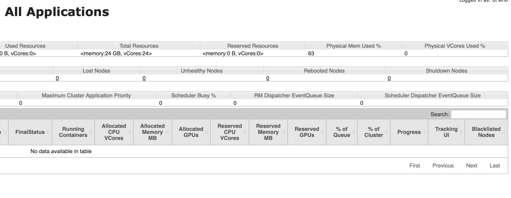
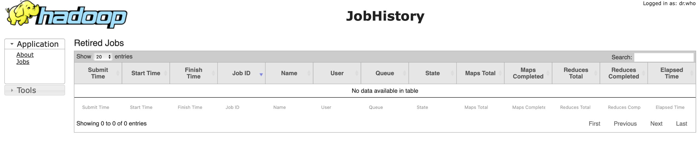
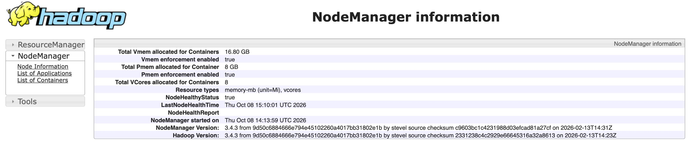

# Домашнее задание №2

Репозиторий содержит пошаговую инструкцию ручного развертывания YARN на базе существующего HDFS-кластера и настройки внешнего доступа к веб-интерфейсам основных и вспомогательных демонов для команды `team28a`.

В результате был развернут YARN-кластер, включающий:

- 1 ResourceManager;
- 3 NodeManager;
- 1 JobHistoryServer.

YARN был развернут поверх HDFS-кластера из домашнего задания №1. Существующая конфигурация HDFS при этом не изменялась.

Итоговая конфигурация кластера:

```text
team-28-nn
├── NameNode
├── DataNode
├── ResourceManager
├── NodeManager
└── JobHistoryServer

team-28-00
├── SecondaryNameNode
├── DataNode
└── NodeManager

team-28-01
├── DataNode
└── NodeManager
```

## Содержание

1. [Исходная инфраструктура](#1-исходная-инфраструктура)
2. [Подключение к edge-узлу](#2-подключение-к-edge-узлу)
3. [Проверка исходного состояния кластера и выбор портов](#3-проверка-исходного-состояния-кластера-и-выбор-портов)
4. [Настройка mapred-site.xml](#4-настройка-mapred-sitexml)
5. [Настройка yarn-site.xml](#5-настройка-yarn-sitexml)
6. [Распространение конфигурации по узлам](#6-распространение-конфигурации-по-узлам)
7. [Запуск ResourceManager](#7-запуск-resourcemanager)
8. [Запуск NodeManager](#8-запуск-nodemanager)
9. [Запуск JobHistoryServer](#9-запуск-jobhistoryserver)
10. [Финальная проверка процессов](#10-финальная-проверка-процессов)
11. [Проверка логов Hadoop](#11-проверка-логов-hadoop)
12. [Публикация и проверка Web UI](#12-публикация-и-проверка-web-ui)
13. [Итог](#13-итог)


## 1. Исходная инфраструктура

Домашнее задание №2 выполняется на базе HDFS-кластера, развернутого в домашнем задании №1.

Для команды `team28a` используются следующие виртуальные машины:

| Узел | Внутренний IP | Роль до выполнения ДЗ №2 |
|---|---|---|
| `team-28-en` | `10.28.0.10` | edge-узел |
| `team-28-nn` | `10.28.0.11` | NameNode + DataNode |
| `team-28-00` | `10.28.0.12` | SecondaryNameNode + DataNode |
| `team-28-01` | `10.28.0.13` | DataNode |

Edge-узел `team-28-en` используется для входа во внутреннюю сеть и управления Hadoop-узлами. Hadoop-демоны на нем не запускаются.

Перед началом ДЗ №2 на трех внутренних узлах уже установлены:

```text
Java 11
Hadoop 3.4.3
```

Java и Hadoop расположены в пользовательских каталогах:

```text
/home/team28a/apps/java
/home/team28a/apps/hadoop
```

Существующая архитектура HDFS:

```text
team-28-nn
├── NameNode
└── DataNode

team-28-00
├── SecondaryNameNode
└── DataNode

team-28-01
└── DataNode
```

В рамках ДЗ №2 поверх существующего HDFS-кластера разворачиваются YARN и JobHistoryServer.

## 2. Подключение к edge-узлу

Все действия по настройке кластера выполняются под пользователем `team28a`.

Подключение к инфраструктуре производится через внешний адрес edge-узла:

```bash
ssh team28a@2.59.83.133
```

После успешного подключения командная строка имеет вид:

```text
team28a@team-28-en:~$
```

Для подключения с edge-узла к внутренним машинам используется SSH-ключ:

```text
~/.ssh/team28a_internal
```

Он был настроен при выполнении домашнего задания №1.

Подключение к внутренним узлам выполняется командами:

```bash
ssh -i ~/.ssh/team28a_internal team28a@team-28-nn
```

```bash
ssh -i ~/.ssh/team28a_internal team28a@team-28-00
```

```bash
ssh -i ~/.ssh/team28a_internal team28a@team-28-01
```

В дальнейших шагах команды для внутренних узлов запускаются с `team-28-en` через этот SSH-ключ.

## 3. Проверка исходного состояния кластера и выбор портов

Перед настройкой YARN проверяем, что HDFS из домашнего задания №1 продолжает работать на всех трех внутренних узлах.

На `team-28-nn`:

```bash
ssh -i ~/.ssh/team28a_internal team28a@team-28-nn \
  'JAVA_HOME=$HOME/apps/java $HOME/apps/java/bin/jps'
```

Полученные процессы:

```text
NameNode
DataNode
Jps
```

На `team-28-00`:

```bash
ssh -i ~/.ssh/team28a_internal team28a@team-28-00 \
  'JAVA_HOME=$HOME/apps/java $HOME/apps/java/bin/jps'
```

Полученные процессы:

```text
SecondaryNameNode
DataNode
Jps
```

На `team-28-01`:

```bash
ssh -i ~/.ssh/team28a_internal team28a@team-28-01 \
  'JAVA_HOME=$HOME/apps/java $HOME/apps/java/bin/jps'
```

Полученные процессы:

```text
DataNode
Jps
```

После этого проверяем стандартные порты YARN. Виртуальные машины используются двумя командами, поэтому TCP-порты являются общими для пользователей `team28a` и `team28b`.

На `team-28-nn`:

```bash
ssh -i ~/.ssh/team28a_internal team28a@team-28-nn \
  'ss -ltn | grep -E ":(8030|8031|8032|8033|8040|8042|8088|10020|10033|19888)([[:space:]]|$)" || true'
```

На `team-28-00`:

```bash
ssh -i ~/.ssh/team28a_internal team28a@team-28-00 \
  'ss -ltn | grep -E ":(8040|8042)([[:space:]]|$)" || true'
```

На `team-28-01`:

```bash
ssh -i ~/.ssh/team28a_internal team28a@team-28-01 \
  'ss -ltn | grep -E ":(8040|8042)([[:space:]]|$)" || true'
```

Проверка показала, что часть стандартных YARN-портов уже занята.

Проверяем владельцев работающих YARN-процессов.

На `team-28-nn`:

```bash
ssh -i ~/.ssh/team28a_internal team28a@team-28-nn \
  'ps -eo user,pid,cmd | grep -E "[R]esourceManager|[N]odeManager|[J]obHistoryServer"'
```

На `team-28-00`:

```bash
ssh -i ~/.ssh/team28a_internal team28a@team-28-00 \
  'ps -eo user,pid,cmd | grep -E "[R]esourceManager|[N]odeManager|[J]obHistoryServer"'
```

На `team-28-01`:

```bash
ssh -i ~/.ssh/team28a_internal team28a@team-28-01 \
  'ps -eo user,pid,cmd | grep -E "[R]esourceManager|[N]odeManager|[J]obHistoryServer"'
```

Проверка показала, что стандартные YARN-порты используются процессами пользователя `team28b`. Эти процессы не изменяются и не останавливаются.

Дополнительно проверяем стандартный порт MapReduce ShuffleHandler и выбранный для нашей команды альтернативный порт:

```bash
ssh -i ~/.ssh/team28a_internal team28a@team-28-nn \
  'ss -ltn | grep -E ":(13562|28562)([[:space:]]|$)" || true'
```

Порт `13562` уже занят, поэтому для `team28a` используется отдельный порт `28562`.

Для исключения конфликтов выбираем отдельный набор портов:

| Сервис | Назначение | Порт |
|---|---|---:|
| ResourceManager | scheduler | `28030` |
| ResourceManager | resource tracker | `28031` |
| ResourceManager | client RPC | `28032` |
| ResourceManager | admin | `28033` |
| ResourceManager | Web UI | `28088` |
| NodeManager | localizer | `28040` |
| NodeManager | Web UI | `28042` |
| MapReduce ShuffleHandler | shuffle | `28562` |
| JobHistoryServer | RPC | `28120` |
| JobHistoryServer | admin | `28133` |
| JobHistoryServer | Web UI | `28188` |

Перед использованием проверяем, что выбранные порты свободны на всех трех узлах:

```bash
for host in team-28-nn team-28-00 team-28-01; do
  echo "===== $host ====="
  ssh -i ~/.ssh/team28a_internal team28a@$host \
    'ss -ltn | grep -E ":(28030|28031|28032|28033|28040|28042|28088|28120|28133|28188|28562)([[:space:]]|$)" || true'
done
```

В результате после имени каждого узла строки `LISTEN` отсутствуют - выбранные порты свободны и могут использоваться кластером `team28a`.

## 4. Настройка `mapred-site.xml`

Файл `mapred-site.xml` создается на edge-узле `team-28-en`, после чего будет скопирован на все три Hadoop-узла.

Создаем файл:

```bash
cat > ~/mapred-site.xml <<'EOF'
<?xml version="1.0"?>
<?xml-stylesheet type="text/xsl" href="configuration.xsl"?>
<configuration>

    <property>
        <name>mapreduce.framework.name</name>
        <value>yarn</value>
    </property>

    <property>
        <name>mapreduce.application.classpath</name>
        <value>$HADOOP_HOME/share/hadoop/mapreduce/*:$HADOOP_HOME/share/hadoop/mapreduce/lib/*</value>
    </property>

    <property>
        <name>mapreduce.shuffle.port</name>
        <value>28562</value>
    </property>

    <property>
        <name>mapreduce.jobhistory.address</name>
        <value>team-28-nn:28120</value>
    </property>

    <property>
        <name>mapreduce.jobhistory.admin.address</name>
        <value>team-28-nn:28133</value>
    </property>

    <property>
        <name>mapreduce.jobhistory.webapp.address</name>
        <value>team-28-nn:28188</value>
    </property>

    <property>
        <name>mapreduce.jobhistory.bind-host</name>
        <value>0.0.0.0</value>
    </property>

</configuration>
EOF
```

В конфигурации:

- `mapreduce.framework.name=yarn` задает выполнение MapReduce через YARN;
- `mapreduce.application.classpath` задает classpath библиотек MapReduce;
- `mapreduce.shuffle.port=28562` задает отдельный порт ShuffleHandler для `team28a`;
- `mapreduce.jobhistory.address` задает RPC-адрес JobHistoryServer;
- `mapreduce.jobhistory.admin.address` задает административный адрес JobHistoryServer;
- `mapreduce.jobhistory.webapp.address` задает адрес Web UI JobHistoryServer;
- `mapreduce.jobhistory.bind-host=0.0.0.0` разрешает JobHistoryServer принимать подключения через сетевые интерфейсы узла.

JobHistoryServer размещается на `team-28-nn`.

## 5. Настройка `yarn-site.xml`

Файл `yarn-site.xml` создается на edge-узле `team-28-en`.

Создаем конфигурацию YARN:

```bash
cat > ~/yarn-site.xml <<'EOF'
<?xml version="1.0"?>
<?xml-stylesheet type="text/xsl" href="configuration.xsl"?>
<configuration>

    <property>
        <name>yarn.nodemanager.aux-services</name>
        <value>mapreduce_shuffle</value>
    </property>

    <property>
        <name>yarn.nodemanager.env-whitelist</name>
        <value>JAVA_HOME,HADOOP_COMMON_HOME,HADOOP_HDFS_HOME,HADOOP_CONF_DIR,CLASSPATH_PREPEND_DISTCACHE,HADOOP_YARN_HOME,HADOOP_HOME,PATH,LANG,TZ,HADOOP_MAPRED_HOME</value>
    </property>

    <property>
        <name>yarn.resourcemanager.hostname</name>
        <value>team-28-nn</value>
    </property>

    <property>
        <name>yarn.resourcemanager.scheduler.address</name>
        <value>team-28-nn:28030</value>
    </property>

    <property>
        <name>yarn.resourcemanager.resource-tracker.address</name>
        <value>team-28-nn:28031</value>
    </property>

    <property>
        <name>yarn.resourcemanager.address</name>
        <value>team-28-nn:28032</value>
    </property>

    <property>
        <name>yarn.resourcemanager.admin.address</name>
        <value>team-28-nn:28033</value>
    </property>

    <property>
        <name>yarn.resourcemanager.webapp.address</name>
        <value>team-28-nn:28088</value>
    </property>

    <property>
        <name>yarn.resourcemanager.bind-host</name>
        <value>0.0.0.0</value>
    </property>

    <property>
        <name>yarn.nodemanager.localizer.address</name>
        <value>0.0.0.0:28040</value>
    </property>

    <property>
        <name>yarn.nodemanager.webapp.address</name>
        <value>0.0.0.0:28042</value>
    </property>

    <property>
        <name>yarn.nodemanager.bind-host</name>
        <value>0.0.0.0</value>
    </property>

    <property>
        <name>mapreduce.shuffle.port</name>
        <value>28562</value>
    </property>

</configuration>
EOF
```

Проверяем созданный файл:

```bash
cat ~/yarn-site.xml
```

Основные параметры конфигурации:

- `yarn.nodemanager.aux-services=mapreduce_shuffle` включает вспомогательный сервис ShuffleHandler на NodeManager;
- `yarn.nodemanager.env-whitelist` задает переменные окружения, передаваемые контейнерам YARN;
- `yarn.resourcemanager.hostname=team-28-nn` размещает ResourceManager на узле `team-28-nn`;
- порты `28030`–`28033` используются сервисами ResourceManager;
- `28088` используется Web UI ResourceManager;
- `28040` используется локализатором NodeManager;
- `28042` используется Web UI NodeManager;
- `28562` используется ShuffleHandler;
- `yarn.resourcemanager.bind-host=0.0.0.0` и `yarn.nodemanager.bind-host=0.0.0.0` позволяют сервисам принимать подключения через сетевые интерфейсы узлов.

Одинаковый `yarn-site.xml` используется на всех трех внутренних узлах.

## 6. Распространение конфигурации по узлам

После создания файлов `mapred-site.xml` и `yarn-site.xml` их необходимо разместить в каталоге конфигурации Hadoop на всех трех внутренних узлах:

```text
~/apps/hadoop/etc/hadoop/
```

Финальный `mapred-site.xml` копируем на все три узла:

```bash
for host in team-28-nn team-28-00 team-28-01; do
  scp -i ~/.ssh/team28a_internal ~/mapred-site.xml \
    team28a@$host:~/apps/hadoop/etc/hadoop/mapred-site.xml
done
```

Файл `yarn-site.xml` копируем на `team-28-nn`:

```bash
scp -i ~/.ssh/team28a_internal ~/yarn-site.xml \
  team28a@team-28-nn:~/apps/hadoop/etc/hadoop/yarn-site.xml
```

На `team-28-00`:

```bash
scp -i ~/.ssh/team28a_internal ~/yarn-site.xml \
  team28a@team-28-00:~/apps/hadoop/etc/hadoop/yarn-site.xml
```

На `team-28-01`:

```bash
scp -i ~/.ssh/team28a_internal ~/yarn-site.xml \
  team28a@team-28-01:~/apps/hadoop/etc/hadoop/yarn-site.xml
```

После этого на всех трех Hadoop-узлах используются одинаковые конфигурационные файлы `mapred-site.xml` и `yarn-site.xml`.

ResourceManager будет запущен на `team-28-nn`, а NodeManager — на каждом из трех внутренних узлов.

## 7. Запуск ResourceManager

ResourceManager запускается на узле `team-28-nn`.

С edge-узла `team-28-en` выполняем:

```bash
ssh -i ~/.ssh/team28a_internal team28a@team-28-nn \
  'JAVA_HOME=$HOME/apps/java HADOOP_HOME=$HOME/apps/hadoop $HOME/apps/hadoop/bin/yarn --daemon start resourcemanager'
```

Проверяем, что процесс ResourceManager запущен:

```bash
ssh -i ~/.ssh/team28a_internal team28a@team-28-nn \
  'JAVA_HOME=$HOME/apps/java $HOME/apps/java/bin/jps'
```

В полученном выводе присутствуют:

```text
NameNode
DataNode
ResourceManager
Jps
```

Проверяем, что ResourceManager слушает настроенные порты:

```bash
ssh -i ~/.ssh/team28a_internal team28a@team-28-nn \
  'ss -ltn | grep -E ":(28030|28031|28032|28033|28088)([[:space:]]|$)"'
```

Получены порты:

```text
28030
28031
28032
28033
28088
```

В результате сервисы ResourceManager привязаны к `0.0.0.0` и принимают подключения от остальных узлов кластера.

## 8. Запуск NodeManager

NodeManager запускается на каждом из трех внутренних Hadoop-узлов.

На `team-28-nn`:

```bash
ssh -i ~/.ssh/team28a_internal team28a@team-28-nn \
  'JAVA_HOME=$HOME/apps/java HADOOP_HOME=$HOME/apps/hadoop $HOME/apps/hadoop/bin/yarn --daemon start nodemanager'
```

На `team-28-00`:

```bash
ssh -i ~/.ssh/team28a_internal team28a@team-28-00 \
  'JAVA_HOME=$HOME/apps/java HADOOP_HOME=$HOME/apps/hadoop $HOME/apps/hadoop/bin/yarn --daemon start nodemanager'
```

На `team-28-01`:

```bash
ssh -i ~/.ssh/team28a_internal team28a@team-28-01 \
  'JAVA_HOME=$HOME/apps/java HADOOP_HOME=$HOME/apps/hadoop $HOME/apps/hadoop/bin/yarn --daemon start nodemanager'
```

Проверяем на `team-28-nn`, что NodeManager использует настроенные порты:

```bash
ssh -i ~/.ssh/team28a_internal team28a@team-28-nn \
  'ss -ltn | grep -E ":(28040|28042|28562)([[:space:]]|$)" || true'
```

Получены порты:

```text
28040  — NodeManager localizer
28042  — NodeManager Web UI
28562  — MapReduce ShuffleHandler
```

После запуска всех трех NodeManager проверяем их регистрацию в ResourceManager:

```bash
ssh -i ~/.ssh/team28a_internal team28a@team-28-nn \
  'JAVA_HOME=$HOME/apps/java HADOOP_HOME=$HOME/apps/hadoop $HOME/apps/hadoop/bin/yarn node -list'
```

В результате ResourceManager видит три узла:

```text
Total Nodes:3
```

Все три NodeManager находятся в состоянии `RUNNING`:

```text
team-28-nn.hse.c.mws    RUNNING
team-28-00.hse.c.mws    RUNNING
team-28-01.hse.c.mws    RUNNING
```

После этого основная часть YARN-кластера состоит из одного ResourceManager и трех зарегистрированных NodeManager.

## 9. Запуск JobHistoryServer

JobHistoryServer запускается на узле `team-28-nn`.

С edge-узла `team-28-en` выполняем:

```bash
ssh -i ~/.ssh/team28a_internal team28a@team-28-nn \
  'JAVA_HOME=$HOME/apps/java HADOOP_HOME=$HOME/apps/hadoop $HOME/apps/hadoop/bin/mapred --daemon start historyserver'
```

Проверяем, что процесс JobHistoryServer появился:

```bash
ssh -i ~/.ssh/team28a_internal team28a@team-28-nn \
  'JAVA_HOME=$HOME/apps/java $HOME/apps/java/bin/jps'
```

В полученном выводе на `team-28-nn` присутствуют:

```text
NameNode
DataNode
ResourceManager
NodeManager
JobHistoryServer
Jps
```

Проверяем, что JobHistoryServer слушает настроенные порты:

```bash
ssh -i ~/.ssh/team28a_internal team28a@team-28-nn \
  'ss -ltn | grep -E ":(28120|28133|28188)([[:space:]]|$)"'
```

Получены порты:

```text
28120  — RPC
28133  — admin
28188  — Web UI
```

В рабочей конфигурации эти порты привязаны к `0.0.0.0`, поэтому JobHistoryServer доступен через сетевые интерфейсы узла.

## 10. Финальная проверка процессов

После запуска ResourceManager, трех NodeManager и JobHistoryServer проверяем процессы на всех трех внутренних узлах.

С edge-узла `team-28-en` выполняем:

```bash
for host in team-28-nn team-28-00 team-28-01; do
  echo "===== $host ====="
  ssh -i ~/.ssh/team28a_internal team28a@$host \
    'JAVA_HOME=$HOME/apps/java $HOME/apps/java/bin/jps'
  echo
done
```

На `team-28-nn` запущены:

```text
NameNode
DataNode
ResourceManager
NodeManager
JobHistoryServer
Jps
```

На `team-28-00`:

```text
SecondaryNameNode
DataNode
NodeManager
Jps
```

На `team-28-01`:

```text
DataNode
NodeManager
Jps
```

Дополнительно проверяем состояние YARN-кластера:

```bash
ssh -i ~/.ssh/team28a_internal team28a@team-28-nn \
  'JAVA_HOME=$HOME/apps/java HADOOP_HOME=$HOME/apps/hadoop $HOME/apps/hadoop/bin/yarn node -list'
```

Полученный результат:

```text
Total Nodes:3
```

Все три NodeManager находятся в состоянии `RUNNING`.

Итоговая архитектура работающего кластера:

```text
team-28-nn
├── NameNode
├── DataNode
├── ResourceManager
├── NodeManager
└── JobHistoryServer

team-28-00
├── SecondaryNameNode
├── DataNode
└── NodeManager

team-28-01
├── DataNode
└── NodeManager
```

## 11. Проверка логов Hadoop

После запуска YARN проверяем логи ResourceManager, NodeManager и JobHistoryServer на наличие критических ошибок.

### ResourceManager на `team-28-nn`

```bash
ssh -i ~/.ssh/team28a_internal team28a@team-28-nn '
LOG=$(ls -t ~/apps/hadoop/logs/*resourcemanager*.log | head -n 1)
tail -n 150 "$LOG" | grep -E "ERROR|FATAL|Exception" || echo "OK: critical errors not found"
'
```

Полученный результат:

```text
OK: critical errors not found
```

### NodeManager на `team-28-nn`

Поскольку в лог-файле могут сохраняться сообщения от предыдущих запусков, проверяем только текущий запуск NodeManager, начиная с последнего `STARTUP_MSG`:

```bash
ssh -i ~/.ssh/team28a_internal team28a@team-28-nn '
LOG=$(ls -t ~/apps/hadoop/logs/*nodemanager*.log | head -n 1)
START=$(grep -n "STARTUP_MSG: Starting NodeManager" "$LOG" | tail -n 1 | cut -d: -f1)
echo "===== current NodeManager run ====="
tail -n +"$START" "$LOG" | grep -E "ERROR|FATAL|Exception" || echo "OK: critical errors not found in current run"
'
```

Полученный результат:

```text
===== current NodeManager run =====
OK: critical errors not found in current run
```

### JobHistoryServer на `team-28-nn`

```bash
ssh -i ~/.ssh/team28a_internal team28a@team-28-nn '
LOG=$(ls -t ~/apps/hadoop/logs/*historyserver*.log | head -n 1)
tail -n 150 "$LOG" | grep -E "ERROR|FATAL|Exception" || echo "OK: critical errors not found"
'
```

Полученный результат:

```text
OK: critical errors not found
```

### NodeManager на `team-28-00` и `team-28-01`

```bash
for host in team-28-00 team-28-01; do
  echo "===== $host: NodeManager ====="
  ssh -i ~/.ssh/team28a_internal team28a@$host '
  LOG=$(ls -t ~/apps/hadoop/logs/*nodemanager*.log | head -n 1)
  tail -n 150 "$LOG" | grep -E "ERROR|FATAL|Exception" || echo "OK: critical errors not found"
  '
done
```

Для обоих узлов получен результат:

```text
OK: critical errors not found
```

Таким образом, текущие запуски ResourceManager, трех NodeManager и JobHistoryServer работают без критических ошибок.

## 12. Публикация и проверка Web UI

Сначала проверяем доступность веб-интерфейсов из внутренней сети кластера.

На edge-узле `team-28-en` выполняем:

```bash
for url in \
  http://team-28-nn:28088 \
  http://team-28-nn:28188 \
  http://team-28-nn:28042 \
  http://team-28-00:28042 \
  http://team-28-01:28042
do
  echo -n "$url -> "
  curl -s -o /dev/null -w "HTTP %{http_code}\n" "$url"
done
```

В результате все пять адресов отвечают:

```text
HTTP 302
```

Код `302` означает перенаправление с корневого URL на страницу соответствующего Hadoop Web UI.

Для доступа к интерфейсам с внешней машины используется SSH port forwarding через edge-узел `team-28-en`.

Команда выполняется на локальном компьютере, а не на сервере:

```bash
ssh -N \
  -L 8088:team-28-nn:28088 \
  -L 19888:team-28-nn:28188 \
  -L 8042:team-28-nn:28042 \
  -L 8043:team-28-00:28042 \
  -L 8044:team-28-01:28042 \
  team28a@2.59.83.133
```

После запуска команды SSH-сессия остается открытой и поддерживает туннели.

В браузере доступны следующие адреса:

| Локальный адрес | Сервис |
|---|---|
| `http://localhost:8088` | ResourceManager |
| `http://localhost:19888` | JobHistoryServer |
| `http://localhost:8042` | NodeManager на `team-28-nn` |
| `http://localhost:8043` | NodeManager на `team-28-00` |
| `http://localhost:8044` | NodeManager на `team-28-01` |

### ResourceManager Web UI

В ResourceManager Web UI отображаются три активных NodeManager:

```text
Active Nodes: 3
Lost Nodes: 0
Unhealthy Nodes: 0
```



### JobHistoryServer Web UI

JobHistoryServer доступен по адресу:

```text
http://localhost:19888
```

Так как отдельные MapReduce-задания в рамках данной работы не запускались, список завершенных заданий пуст.



### NodeManager Web UI

Web UI NodeManager показывает состояние узла и информацию о доступных ресурсах. Для работающего NodeManager значение `NodeHealthStatus` равно `true`.



Таким образом, Web UI ResourceManager, JobHistoryServer и всех трех NodeManager доступны с внешней машины через SSH-туннель.

## 13. Итог

В результате домашнего задания №2 поверх существующего HDFS-кластера был вручную развернут YARN.

Настроены и проверены:

- 1 ResourceManager;
- 3 NodeManager;
- 1 JobHistoryServer;
- вспомогательный сервис `mapreduce_shuffle`;
- отдельный набор портов для YARN-кластера `team28a`;
- регистрация трех NodeManager в ResourceManager;
- отсутствие критических ошибок в текущих логах;
- Web UI ResourceManager;
- Web UI JobHistoryServer;
- Web UI NodeManager.

ResourceManager видит три активных NodeManager:

```text
Total Nodes:3
```

Все три NodeManager находятся в состоянии:

```text
RUNNING
```

Веб-интерфейсы доступны с внешнего компьютера через SSH port forwarding через edge-узел `team-28-en`:

```text
http://localhost:8088   — ResourceManager
http://localhost:19888  — JobHistoryServer
http://localhost:8042   — NodeManager team-28-nn
http://localhost:8043   — NodeManager team-28-00
http://localhost:8044   — NodeManager team-28-01
```
